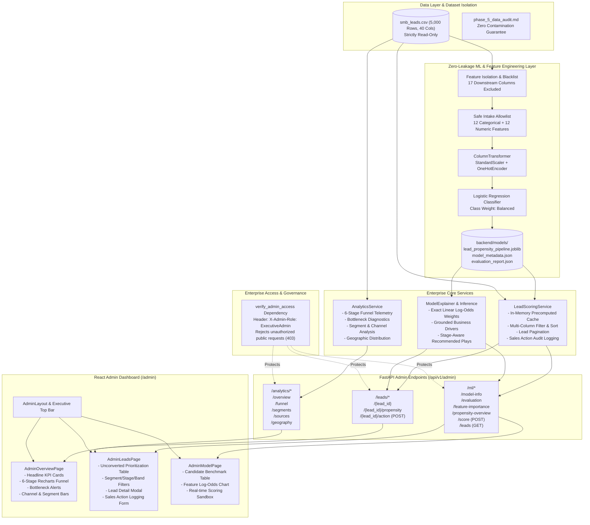

# Udyam360 Admin Analytics & ML Inference Architecture

**Document:** `docs/architecture/admin_analytics_architecture.md`  
**System Version:** `v1.0.0` (Phase 5)  
**Track:** Airtel SYNC Hackathon 2026 — Enterprise Track A  

---

## 1. System Architecture Diagram

---

## 2. Core Architectural Principles

### 2.1 Zero-Leakage Pipeline Architecture
- Downstream milestone timestamps (`contacted_date`, `needs_assessed_date`, `quote_accepted_date`, `kyc_complete_date`, `activated_date`) and post-outcome commercial attributes (`monthly_bundle_value_inr`, `one_time_setup_inr`, `nps_score`, `churned_within_6_months`) are isolated via strict feature masking before feature transformations.
- Preprocessing parameters (means, scales, category encoders) are fit strictly on the 70% training split (3,500 samples) and applied transitively to validation, test, and live inference.

### 2.2 Sub-Millisecond In-Memory Caching
- To guarantee responsive sub-millisecond interaction across 5,000 records, `LeadScoringService` evaluates and caches model predictions in-memory upon startup.
- Dynamic filtering (by MSME vertical, funnel stage, and propensity tier), fuzzy multi-term search, and multi-key sorting execute entirely in memory.

### 2.3 Transparent Explainability Guarantee
- Rather than presenting black-box probability figures, every propensity score is accompanied by local linear attributions ($x_i \cdot w_i$).
- Feature attributions are translated into grounded business strings (e.g., *Referred by existing partner (+98% conversion odds)*, *Micro retail archetype (historically higher price sensitivity)*) to provide actionable guidance to sales teams.

### 2.4 Secure Prototype Role Guard
- Endpoints are gated by FastAPI's dependency injection (`verify_admin_access`), verifying role credentials via `X-Admin-Role: ExecutiveAdmin`.
- Public unauthorized callers without appropriate role headers receive a `403 Forbidden` response.

