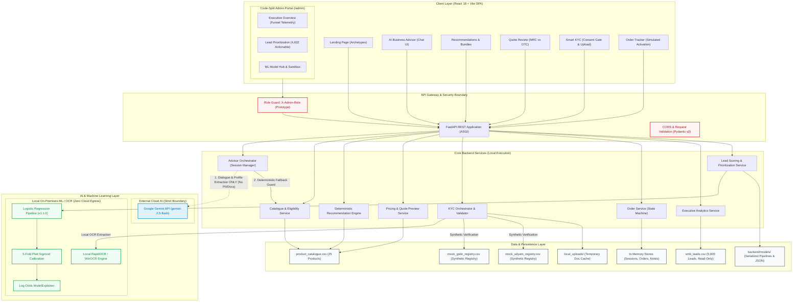

# Udyam360 — Final End-to-End System Architecture

**Project:** Udyam360 — Airtel SYNC Hackathon 2026 (Enterprise Track A, Project Udyam Digital)  
**Document:** `docs/architecture/final_system_architecture.md`  
**Date:** November 6, 2026  
**Status:** **FINAL SUBMISSION ARCHITECTURE**

---

## 1. High-Level Architectural Blueprint

---

## 2. Component Boundaries & Execution Architecture

### 2.1 The Gemini API Boundary (Cloud vs. Local Isolation)
To guarantee strict compliance with enterprise privacy standards and India's DPDP Act:
* **What Communicates with Gemini:**
  * Only natural-language business descriptions provided in the conversational advisor chat (e.g., *"I run a pharmacy in Bengaluru with 4 staff and ₹4,000 monthly telecom spend"*).
  * Gemini extracts structured MSME profile attributes (segment, headcount, location, budget).
* **What NEVER Communicates with Gemini:**
  * **Zero KYC Document Egress:** Document bytes, images, and text extracted by OCR **never** leave the local server and are **never** passed to Gemini.
  * **Zero Registry Data Egress:** Tax IDs, GSTINs, and Udyam numbers are validated strictly against local mock CSVs.
  * **Zero Product Pricing Control:** Product eligibility, pricing rules, bundle scoring, and discount allocations are 100% deterministic code executing locally on the backend. Gemini has zero authority over prices.

### 2.2 Local OCR Processing Pipeline
* **Engine:** RapidOCR (ONNX runtime) with Windows Media OCR (`winocr`) fallback.
* **Execution:** 100% on-premises / local CPU inference.
* **Function:** Extracts document type, registration ID, enterprise name, address, and date of issue from uploaded PDF/PNG/JPEG files.
* **Cross-Validation:** Directly matches extracted names and identifiers against the customer's onboarding profile and the local synthetic registries.

### 2.3 Synthetic / Mock Registry Boundary
* **Registries:** `mock_gstin_registry.csv` and `mock_udyam_registry.csv`.
* **Nature:** Strictly simulated hackathon fixtures containing synthetic enterprise records.
* **Disclosure:** No real-time government GSTN or Ministry of MSME Udyam portals are queried. Active/Suspended/Cancelled states reflect the mock dataset.

### 2.4 Lead Propensity Machine Learning Pipeline
* **Algorithm:** Standardized Logistic Regression pipeline (`ColumnTransformer` with `StandardScaler` for numeric values and `OneHotEncoder(handle_unknown='ignore')` for categoricals).
* **Probability Calibration:** 5-fold cross-validated Platt Sigmoid Calibration (`CalibratedClassifierCV(method='sigmoid', cv=5)`) fit strictly on the Train + Validation splits (4,250 samples). The held-out test fold (750 samples) remained untouched.
* **Brier Score:** Calibrated Brier score of **0.0666** on held-out test data, outperforming the naive prior baseline ($0.0733 \times (1 - 0.0733) = \mathbf{0.0680}$).
* **Explainability:** Log-odds attribution ($\beta_i \cdot x_i$) with mathematically bounded percentage changes ($(\exp(\beta_i) - 1) \times 100\% \ge -100\%$) and explicit non-causal disclosures.
* **Lead Population:** Scores all 4,632 actionable unconverted leads; strictly quarantines 368 already-activated accounts with `ALREADY_ACTIVATED` flags.

### 2.5 Simulated Order Fulfillment
* **State Machine:** `Order Created` $\rightarrow$ `Document Verification` $\rightarrow$ `Commercial Approval` $\rightarrow$ `Provisioning` $\rightarrow$ `Simulated Activation`.
* **Disclosure:** In a hackathon environment without live telco network OSS/BSS connectors, service provisioning and circuit activation are explicitly simulated.

---

## 3. Technology Stack Inventory

| Tier | Component | Technology & Version | Purpose |
| :--- | :--- | :--- | :--- |
| **Frontend** | Framework | React 18.3.1 + TypeScript 5.6.3 | Modern, type-safe web application |
| | Build Tool | Vite 5.4.11 (with Rollup Code Splitting) | Sub-second HMR, optimized multi-chunk bundle |
| | Styling | Tailwind CSS 3.4.15 | Responsive, utility-first enterprise design |
| | Visualizations | Recharts 3.10.1 (Code-split to `/admin`) | Funnel drop-offs, segment bars, channel metrics |
| | Icons | Lucide React 0.468.0 | Consistent iconography |
| | Client Routing | React Router v6.28.0 | Declarative client-side routing & Suspense gates |
| **Backend** | Framework | FastAPI 0.162.0 (ASGI) + Uvicorn 0.54.0 | High-performance asynchronous REST API |
| | Validation | Pydantic v2.14.3 | Strict request/response typing and validation |
| | Environment | Python 3.13.7 (64-bit) | Modern Python runtime |
| **AI / ML** | Conversational AI | Google Gemini API (`google-genai` SDK) | Natural language dialogue & profile extraction |
| | Local OCR | RapidOCR ONNX / WinOCR | Local document text extraction |
| | Propensity ML | Scikit-learn 1.9.1 | Logistic Regression & Platt Calibrated Classifier |
| | Data Science | Pandas 3.1.1 & NumPy 2.5.4 | Feature engineering and analytics aggregation |
| **Testing** | Backend Tests | PyTest 9.2.0 + AnyIO | 138 passing unit, integration & scenario tests |
| | Frontend Tests | Vitest 2.1.8 + JSDOM | 17 passing React Testing Library tests |
| **Deliverables**| Presentations | `python-pptx` 1.0.2 | 10-slide enterprise presentation generator |
| | Documents | `reportlab` 5.1.0 | 1-page privacy & security note PDF generator |

