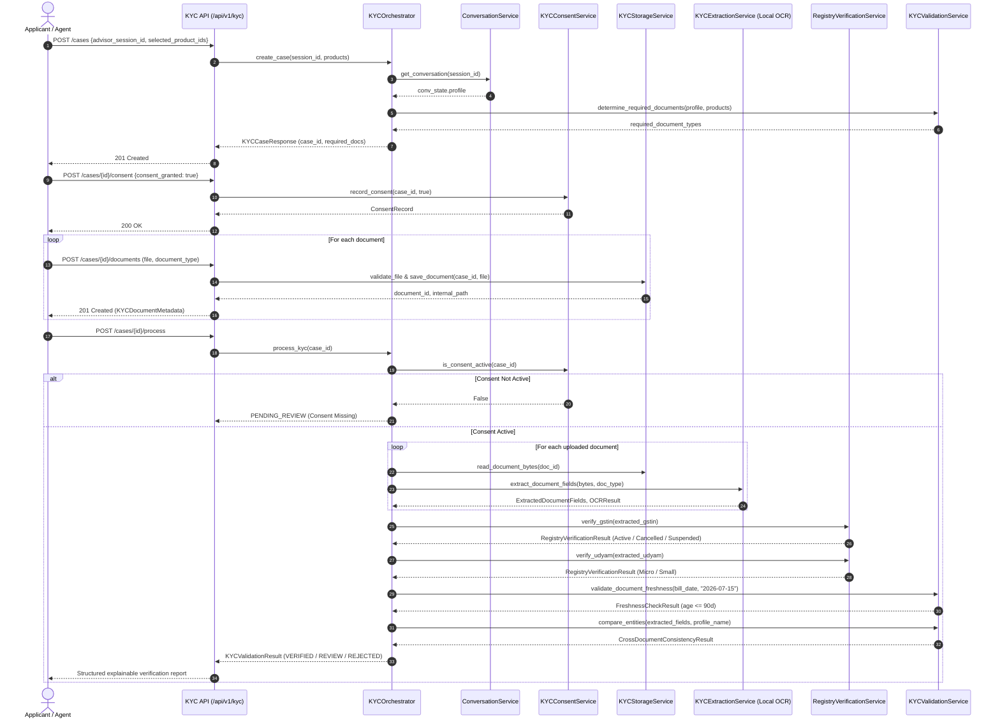

# Udyam360: Smart KYC & Document Verification Architecture

## 1. System Overview

The **Udyam360 Smart KYC subsystem** bridges conversational business onboarding (Phase 2) with deterministic regulatory verification. It processes applicant document images (GST certificates, Udyam certificates, utility bills, and signatory IDs) using local, privacy-preserving Optical Character Recognition (OCR), cross-document semantic matching, and synthetic mock registry lookups.

### Architectural Principle: Zero External Cloud OCR / Zero Gemini Leakage

```
┌────────────────────────────────────────────────────────────────────────┐
│                        ADVISOR ONBOARDING (PHASE 2)                    │
│  - Conversation State & BusinessProfile Snapshot                      │
│  - Selected Product IDs (e.g., P01, P03, P16)                          │
└───────────────────────────────────┬────────────────────────────────────┘
                                    │
                                    │ Creates KYC Case
                                    ▼
┌────────────────────────────────────────────────────────────────────────┐
│                   SMART KYC PIPELINE (PHASE 3)                         │
│                                                                        │
│   [Consent Gate] ──► [Secure Storage] ──► [Local OCR Engine]           │
│   (KYCConsent)       (Path Isolation)     (WinMediaOCR / RapidOCR)     │
│                             │                       │                  │
│                             ▼                       ▼                  │
│                     [Pillow Sniffer]      [Field Normalizer]           │
│                     (PNG/JPEG verify)     (GSTIN/Udyam Regex)          │
│                                                     │                  │
│                                                     ▼                  │
│                    ┌──────────────────────────────────────────────┐    │
│                    │     DETERMINISTIC VERIFICATION ENGINES       │    │
│                    │  - Mock GST Registry (Active/Cancelled)      │    │
│                    │  - Mock Udyam Registry (Micro/Small)         │    │
│                    │  - Freshness Checker (90d vs 2026-07-15)     │    │
│                    │  - Cross-Document Entity Similarity (>=0.75) │    │
│                    └──────────────────────┬───────────────────────┘    │
└───────────────────────────────────────────┼────────────────────────────┘
                                            │
                                            ▼
┌────────────────────────────────────────────────────────────────────────┐
│                        EXPLAINABLE OUTCOME                             │
│   - VERIFIED: All mandatory checks pass cleanly                        │
│   - PENDING_REVIEW: Low OCR conf, minor name variants, suspended GSTIN │
│   - MISSING_DOCUMENTS: Mandatory documents unsubmitted                 │
│   - REJECTED: Confirmed cancelled GSTIN status in registry             │
└────────────────────────────────────────────────────────────────────────┘
```

---

## 2. End-to-End Orchestration Sequence



---

## 3. Subsystem Component Breakdown

### 3.1. Provider-Abstracted Local OCR Engine (`app/services/ocr/`)
- **`BaseOCRProvider` (`ocr/base.py`):** Abstract interface standardizing `extract_text(image_input, preprocess=True) -> OCRResult`.
- **`WinOCRProvider` (`ocr/local_ocr.py`):** Primary Windows 10/11 engine leveraging `winrt.windows.media.ocr`. Delivers sub-200ms processing with zero model downloads.
- **`RapidOCRProvider` (`ocr/local_ocr.py`):** Cross-platform fallback utilizing PaddleOCR PP-OCRv4 ONNX model on CPU.
- **`MockOCRProvider` (`ocr/local_ocr.py`):** Fast, deterministic provider for automated CI/CD testing.
- **`preprocessing.py`:** Applies Pillow-based grayscale conversion, adaptive contrast enhancement (factor 1.5), size scaling (> 1000px), and sharpening filters.

### 3.2. Secure Local Document Storage (`app/services/kyc_storage_service.py`)
- **Directory Isolation:** Files stored under `backend/storage/kyc_documents/{case_id}/`.
- **Sanitization:** User filenames stripped of directory traversal tokens (`..`, `/`, `\`); stored under unique UUIDs (`DOC-XXXXXXXXXXXX.png`).
- **Binary Validation:** Checks MIME magic bytes (`PNG`, `JPEG`, `PDF`) and structural Pillow integrity.

### 3.3. Document Extraction & Field Parsing (`app/services/kyc_extraction_service.py`)
- **GST Certificate Parser:** Normalizes 15-character Indian synthetic GSTINs (allowing embedded PAN 4th character `'X'`); extracts Legal Name, Trade Name, Address, and Liability Date.
- **Udyam Certificate Parser:** Normalizes `UDYAM-XX-00-XXXXXXX` (allowing synthetic district code `'00'`); extracts Enterprise Name, Address, and Registration Date.
- **Address Proof Parser:** Extracts Consumer No, Billed To Name, Supply Address, and Bill Date.
- **Signatory ID Parser:** Extracts Authorized Representative Name, Designation, and Business Name.

### 3.4. Mock Registry Verification (`app/services/registry_verification_service.py`)
- **GSTIN Registry (`mock_gstin_registry.csv`):** Lookups across 3,534 records. Enforces status rules:
  - `Active`: Pass.
  - `Cancelled`: Hard Rejection (`GSTIN_STATUS_CANCELLED`).
  - `Suspended`: Human review required (`GSTIN_STATUS_SUSPENDED`).
- **Udyam Registry (`mock_udyam_registry.csv`):** Lookups across 2,723 records verifying enterprise classification (`Micro`, `Small`, `Medium`).

### 3.5. Deterministic Validation & Consistency Engine (`app/services/kyc_validation_service.py`)
- **Catalogue-Aware Requirement Engine:** Dynamically requires `GST_CERTIFICATE` only if selected products mandate it (`requires_gstin == True` in `product_catalogue.csv`) or customer claims GSTIN.
- **Document Freshness:** Enforces the 90-day validity window relative to the synthetic baseline date **`2026-07-15`**.
- **Cross-Document Entity Matching:** Applies token and sequence-similarity algorithms across documents (`settings.NAME_SIMILARITY_THRESHOLD = 0.75`, `settings.ADDRESS_SIMILARITY_THRESHOLD = 0.70`).

