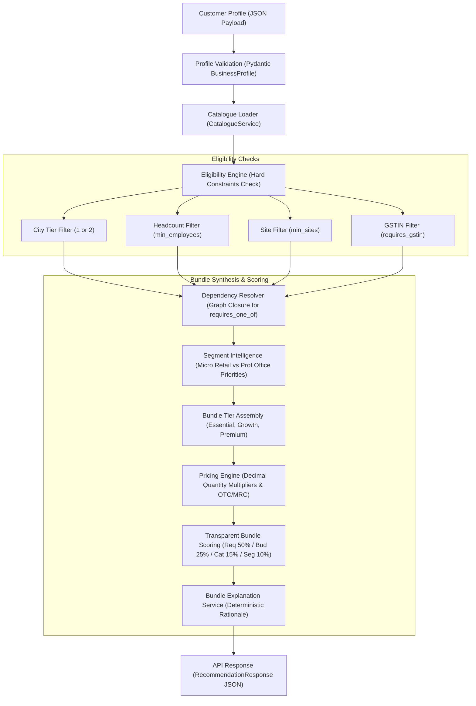

# Architecture: Recommendation Engine & Business Intelligence

**Project:** Udyam360 (Airtel SYNC Hackathon 2026 — Enterprise Track A)  
**Component:** Catalogue Intelligence & Recommendation Engine  
**Version:** Phase 1  

---

## 1. System Flow & Architecture

The recommendation engine is a deterministic, explainable, catalogue-aware pipeline designed to transform customer business profiles into transparent Essential, Growth, and Premium bundle recommendations without LLM hallucinations.

---

## 2. Core Architectural Components

### 2.1. `CatalogueService` (`backend/app/services/catalogue_service.py`)
- Reads from `YTL_TrackA_Udyam_Digital_Data/product_catalogue.csv` without mutating source files.
- Enforces strict referential integrity across all 25 products.
- Validates that every ID referenced in `requires_one_of` exists in the catalogue.
- Guards against duplicate product IDs and negative prices.

### 2.2. `EligibilityEngine` (`backend/app/services/eligibility_engine.py`)
- Evaluates hard constraints:
  - `city_tier`: Filters out products unavailable in the business location (e.g. `P03` restricted to Tier 1).
  - `min_employees`: Rejects applications where `employee_count < min_employees`.
  - `min_sites`: Enforces minimum premises requirement (e.g. `P10` requires ≥ 3 sites).
  - `requires_gstin`: Rejects businesses lacking GSTIN if the product mandates active GST registration.
- Evaluates `NEEDS_INFORMATION` status when unprovided fields prevent definitive determination, avoiding premature rejection.
- Resolves dependency graphs by injecting the lowest-cost eligible prerequisite into candidate bundles.

### 2.3. `SegmentService` (`backend/app/services/segment_service.py`)
- Classifies businesses into target segments:
  - **Micro Retail & Services (`micro`):** Prioritizes affordable broadband, POS billing, WhatsApp/SMS marketing, and CCTV surveillance.
  - **Professional Offices (`prof`):** Prioritizes reliable fibre, custom domain email, cloud backup, endpoint cybersecurity, and cloud telephony.
- Computes suitability scores (0.0 to 1.0) based on category priorities, feature keywords, and target segment tags.

### 2.4. `PricingEngine` (`backend/app/services/pricing_engine.py`)
- Performs high-precision decimal calculations distinguishing:
  - Monthly Recurring Charges (MRC): `[min_inr, max_inr]`
  - One-Time Setup Charges (OTC): `[min_inr, max_inr]`
  - Estimated First-Month Outlay: `Month 1 MRC + OTC`
- Dynamically scales unit pricing by profile attributes (`per user`, `per site`, `per counter`, `per device`, `per line`, `per camera`).

### 2.5. `RecommendationEngine` (`backend/app/services/recommendation_engine.py`)
- Generates 3 distinct options:
  - **Essential:** Lowest recurring cost fulfilling baseline connectivity and key operations.
  - **Growth:** Optimal balance of customer requirements, segment suitability, and affordability.
  - **Premium:** Comprehensive digital setup with advanced security, backup, and communication.
- Implements transparent, weighted multi-factor scoring:
  $$\text{Score} = (\text{ReqMatch} \times 0.50) + (\text{BudgetFit} \times 0.25) + (\text{Eligibility} \times 0.15) + (\text{SegmentSuitability} \times 0.10)$$
- Enforces budget compatibility: marks bundles as `WITHIN_BUDGET` or `EXCEEDS_BUDGET` with exact shortfall calculations.

### 2.6. `BundleExplanationService` (`backend/app/services/bundle_explanation.py`)
- Generates structured, deterministic explanations without LLMs:
  - Identifies which customer requirements are satisfied vs. unmet.
  - Provides per-product justifications based on segment priorities.
  - Discloses minimum contract terms and fulfillment turnaround times.

